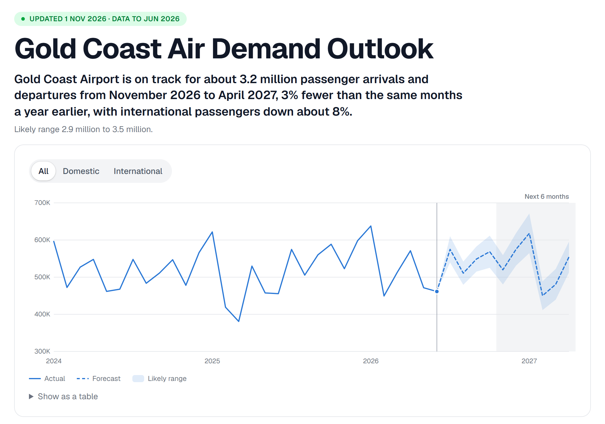
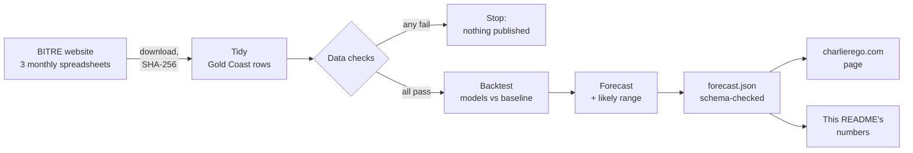

# Gold Coast Air Demand Outlook

[](https://github.com/CharlieRego/gold-coast-air-demand/actions/workflows/checks.yml)
[](data/SOURCES.md)
[](output/forecast.json)

[](LICENSE)

A self-updating forecast of passengers through Gold Coast Airport, built from Australian Government open data.
It answers one question for airports, hotels and tour operators planning around the visitor season:
**how many passengers is the airport likely to handle over the next six months, and how much should you trust that number?**

**Live page:** [charlierego.com/projects/gold-coast-demand](https://charlierego.com/projects/gold-coast-demand)

[](https://charlierego.com/projects/gold-coast-demand)

## Results

<!-- results:start (written by src/export/readme.py on every refresh; don't edit by hand) -->
**Latest forecast**, built 1 Nov 2026 from BITRE data to Jun 2026:

- **About 3.2 million passengers** through Gold Coast Airport, Nov 2026 – Apr 2027 (likely range 2.9–3.5 million), 3% below the same months a year earlier.
- **4.7% average error** 1–6 months ahead in a 12-month backtest, against 7.1% for "same month last year".
- Over the last 12 months this method came in below the real number in about 8 of every 10 test forecasts, by 4% on average, so treat it as a cautious estimate.
<!-- results:end -->

## What this project shows

- **Time-series forecasting:** ETS and seasonal ARIMA (statsmodels), with domestic and international passengers modelled separately and COVID handled two ways, then compared.
- **Honest evaluation:** a rolling-origin backtest against a "same month last year" baseline. Likely ranges come from the backtest errors, and the model's tendency to run low is reported, not tuned away.
- **Data engineering:** automated download with SHA-256 fingerprints, data checks that stop the run before anything bad is published, and a versioned JSON Schema contract for the output.
- **Automation:** a cron job on a Linux server refreshes everything fortnightly and pushes only when the forecast changes. GitHub Actions runs the tests on every push.
- **Communication:** a plain-English web page (Next.js, React) with a new-route scenario tool, and a [decision log](DECISIONS.md) of every choice and the options I tested.

## How it works



| Step | Where | What it does |
|---|---|---|
| Ingest | `src/ingest/` | Finds the newest files on BITRE's pages, downloads them to `data/raw/` (with SHA-256 in `data/raw/manifest.json`), and extracts the Gold Coast rows into `data/processed/` |
| Checks | `src/checks/` | Stops the run if months are missing or duplicated, any value is negative, domestic + international doesn't equal the total, or the latest month doesn't match what BITRE says the file covers |
| Model | `src/model/` | Forecasts domestic and international passengers separately and adds them up. Candidates: ETS and seasonal ARIMA, trained on post-COVID data or on 2009 onward with COVID cut out |
| Backtest | `src/model/backtest.py` | Rolling origin over the last 12 months, 1–12 months ahead, against "same month last year" |
| Export | `src/export/` | Writes `output/forecast.json`, checks it against `schema/forecast.schema.json`, and updates the numbers in this README |
| Refresh | `scripts/refresh.sh` | Runs every second Wednesday at 03:00 Brisbane time on a Sydney server (BITRE blocks overseas cloud servers, so GitHub Actions can't fetch it). Commits only if the forecast changed |
| CI | `.github/workflows/checks.yml` | Runs the tests on every push, including the refresh commits |

## Accuracy

<!-- accuracy:start (written by src/export/readme.py on every refresh; don't edit by hand) -->
Test year Jul 2025 – Jun 2026, 144 forecasts per series. Average % difference between forecast and actual passengers:

| | 1–6 months ahead: model | same month last year | 7–12 months ahead: model | same month last year |
|---|---|---|---|---|
| **Total** | **4.7%** | 7.1% | **4.9%** | 7.1% |
| Domestic | 3.9% | 5.3% | 3.5% | 5.3% |
| International | 14.3% | 19.8% | 19.0% | 19.8% |
<!-- accuracy:end -->

The model's error, the baseline's error and how often the model runs low are all reported as measured, without adjusting the forecast to look better. The reasons behind each choice are in [`DECISIONS.md`](DECISIONS.md), and every individual test forecast is in [`output/backtest.csv`](output/backtest.csv).

## Limitations

- BITRE publishes about three to four months after the month ends, so the forecast starts several months before today.
- Only four years of post-COVID data. The method was chosen on the same 12 months it's scored on.
- International traffic depends on airlines adding or dropping routes, which a model of past passenger numbers can't see coming. Its errors are much larger than domestic.
- Counts are passenger movements on scheduled flights: each arrival and each departure counts once. Charter flights aren't included.

## `forecast.json`

Versioned (`schema_version`), described by [`schema/forecast.schema.json`](schema/forecast.schema.json) and checked by `tests/test_forecast_json.py`. It holds the history from 2019, the monthly forecast with likely ranges, the six-month headline, accuracy results, early indicators from the route and seat files, scenario defaults, and the source of every input.

## Run it

```bash
python -m venv .venv
.venv/Scripts/pip install -r requirements.txt   # Windows; use .venv/bin/pip elsewhere
python -m src.pipeline             # download the latest BITRE files, then process and check
python -m src.pipeline --offline   # reuse files already in data/raw
python -m src.pipeline --offline --today 2026-11-01   # fix the run date
python -m pytest
```

## Data and licence

Sources, licences and retrieval dates: [`data/SOURCES.md`](data/SOURCES.md).

Data: Bureau of Infrastructure and Transport Research Economics (BITRE), © Commonwealth of Australia, CC BY 4.0.
Code: [MIT](LICENSE).

## About

Built by **Charles Rego**, a data professional in Brisbane (Master of Data Science, QUT).

[charlierego.com](https://charlierego.com) · [LinkedIn](https://www.linkedin.com/in/charles-rego) ·
another project: [Queensland hospital data monitoring pipeline](https://charlierego.com/projects/hospital-data-monitoring)
